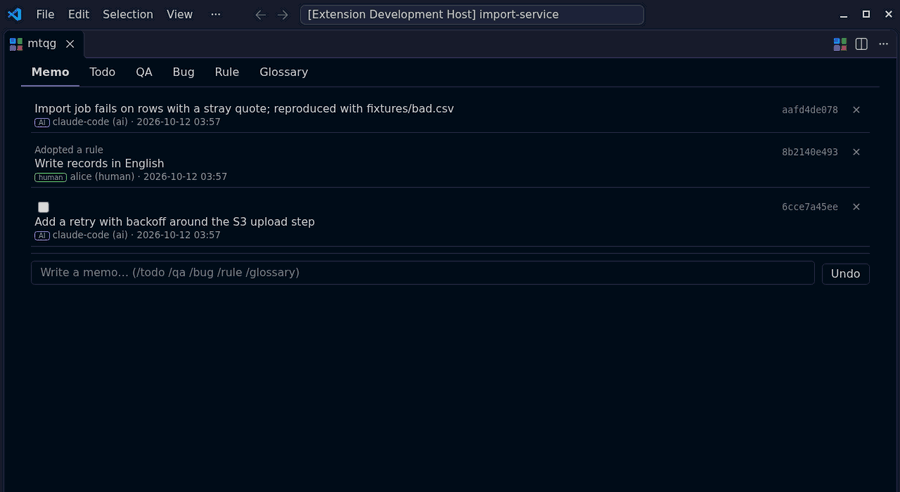

# mtqg for VS Code

*[English](README.md) | **日本語***

  

<strong>mtqgのプロジェクト journal を、エディタの中から見て書く</strong>

  
  
  

  <a href="#features">Features</a> ·
  <a href="#prerequisites">Prerequisites</a> ·
  <a href="#usage">Usage</a> ·
  <a href="#learn-more">Learn more</a>

[mtqg](https://github.com/amisonnet8/mtqg)は、メモ・やること・質問と回答・不具合とそのやり取り・用語の合意（**m**emo & rules・**t**odo・**q**a & bugs・**g**lossary）を、追記だけのjournal（`.mtqg/journal.jsonl`）としてgitリポジトリの中に残すCLIツール——人間とAIエージェントの両方のためのもの。この拡張は、その記録の作成をアシストし、状態と過程をエディタの中から見えるようにする。新しい種類のデータや操作は増やさない：読み書きはすべて`mtqg`のCLI（`--json`付き）を通して行い、`.mtqg/`の中身を直接読み書きすることはない。

## Demo

  

## Features

- 💬 **Memo画面** — すべての記録が流れるチャット風のタイムライン（新しい投稿が下）。普段はメモとして投稿し、`/todo`・`/qa`・`/bug`・`/rule`・`/glossary`で種類を書き分ける
- ✅ **Todo画面** — Google Keep風のカード。チェックボックスで完了・再開
- 🧵 **QA・Bug画面** — 質問・不具合がスレッドになり、回答・返信はいつでも入力欄がすぐそこにある
- 📖 **Rule・Glossary画面** — 決まり事・用語のただの表
- ⌨️ **どの画面もチャット風** — 古い→新しい順に並び、入力欄は画面の下端に固定。新しい記録は入力欄の直上に現れる。下端にいるときだけ最新の記録を追いかけ、上へスクロールして読んでいる間は位置を保つ
- 🏷️ **短縮IDを常に表示** — すべての記録に10桁のID（`mtqg context`と同じもの）を表示。押すと完全なIDをコピーできる。AIエージェントと記録について話すときに便利
- ♻️ **再起動しても続きから** — VS Codeを再起動しても、パネルが同じタブで開き直される
- 🕓 **何も静かには消えない** — 編集・削除は跡を残し、書き込み直後ならいつでもUndoできる。Undoはこの拡張が書いたものだけを戻し、AIエージェントがその間に追加した記録は戻さない
- 🤖 **人間とAIエージェントが同じタイムラインに並ぶ** — それぞれのバッジ付きで、誰の記録か一目で分かる
- 🔗 **`@`でファイルを差し込む** — どの入力欄でも`@`を打つとワークスペースのファイル候補が出て、選ぶとそのパスが本文に入る

## Prerequisites

- `PATH`上に`mtqg` 1.0.0以降が必要——インストール方法は[mtqgリポジトリ](https://github.com/amisonnet8/mtqg)を参照（`go install github.com/amisonnet8/mtqg/cmd/mtqg@latest`、または[Releases](https://github.com/amisonnet8/mtqg/releases)のビルド済みバイナリ）
- `mtqg init`済みのgitリポジトリを開いたワークスペース

`mtqg`が見つからない、またはこの拡張が必要とする版より古い場合、パネルを初めて開いたときに通知で知らせる。

## Usage

**mtqg: Open**を実行すると、6画面（Memo・Todo・QA・Bug・Rule・Glossary）タブのmtqgパネルが開く。Memo画面の入力欄は普段はメモとして投稿し、`/todo`・`/qa`・`/bug`・`/rule`・`/glossary`（または1文字の短縮形`/t`・`/q`・`/b`・`/r`・`/g`）で種類を書き分ける。

すべての記録に短縮IDが表示され、押すと完全なIDをコピーできる。どの入力欄でも——Memo画面の入力欄、各画面の追加欄、返信欄、既存レコードの編集中でも——`@`を打つとワークスペースのファイルを検索でき、選んだパスを本文に挿入できる。

VS Codeを閉じるときにパネルを開いていれば、次に起動したときに同じタブで開き直される。

### Commands

| コマンド | タイトル | 呼び出し場所 |
|---|---|---|
| `mtqg.open` | mtqg: Open | コマンドパレット、エディタタイトルバー |

## Learn more

- [mtqg](https://github.com/amisonnet8/mtqg) — この拡張が入り口を提供しているCLI本体
- [CHANGELOG](CHANGELOG.md)
- [Issues](https://github.com/amisonnet8/mtqg-vscode/issues)

## License

MIT
